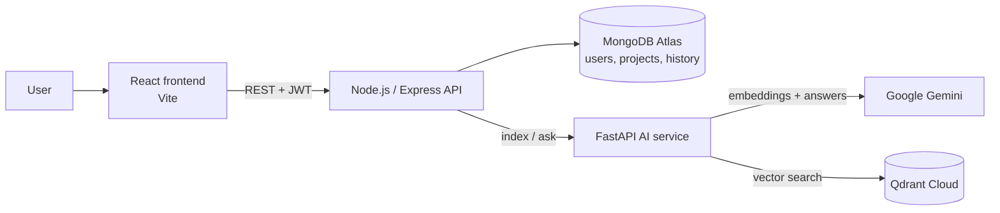

# PolicyResearch AI

**Ask questions about long policy documents and get answers that cite the exact passages they came from.**

PolicyResearch AI is a retrieval-augmented generation (RAG) research assistant. Upload policy PDFs into a project, ask a question in plain language, and get a concise answer from Google Gemini. Every claim is linked to the source passage, so you can check it.

🔗 **Live demo:** https://policyresearch-ai-2.onrender.com
> Runs on free hosting that sleeps when idle. The first sign-in or answer can take about a minute while the servers wake up; after that it's fast.

---

## Features

- **Projects & documents**: organise PDFs into projects; upload by drag and drop; inspect every indexed passage.
- **Cited answers**: answers use only the retrieved passages and cite them inline. Each citation is a clickable link that highlights its source, with a relevance score.
- **Hybrid retrieval**: combines semantic vector search (Qdrant) with keyword search (BM25), filtered to the selected document.
- **Research history & saved answers**: every question is logged; bookmark the useful answers; search both.
- **Secure accounts**: JWT authentication; users can only access their own projects and documents.
- **Responsive UI**: works on desktop and mobile, with automatic dark mode.
- **Built for free hosting**: a daily GitHub Actions job keeps the free databases active, and the UI explains cold starts to visitors.

## Architecture



| Part | Tech | Responsibility |
|---|---|---|
| `frontend/` | React 19, Vite, Tailwind CSS | UI: Ask, History, Saved, Documents, Settings |
| `backend/` | Node.js, Express, MongoDB (Mongoose), JWT | Auth, projects, documents, history, saved answers; PDF text extraction and chunking |
| `ai-service/` | Python, FastAPI, Qdrant, Gemini, rank-bm25 | Embeddings, indexing, hybrid retrieval, answer generation |
| `evaluation/` | Python, scikit-learn | Retrieval and answer-quality benchmarks, run in CI |

## How it works

**Indexing a document**
1. The backend extracts text from the uploaded PDF and splits it into overlapping chunks (150 words, 50-word overlap).
2. The AI service embeds each chunk with `gemini-embedding-001` and stores it in Qdrant, tagged with its document ID.

**Answering a question**
1. The question is embedded, and Qdrant returns the 20 most similar chunks *from the selected document only*.
2. BM25 keyword scores are computed over the same document's chunks.
3. Both scores are normalised and combined (**70% semantic + 30% keyword**), and the top 5 chunks are kept.
4. `gemini-2.5-flash` writes the answer using only those chunks, citing each one as `[Chunk N]`.
5. The answer and sources are saved to the user's history and shown with clickable citations.

## Evaluation

Retrieval was benchmarked on **50 questions** with hand-labelled relevant chunks. Results are in `evaluation/`:

| Method | Recall@5 | Precision@5 | MRR |
|---|---|---|---|
| BM25 (keywords only) | 0.165 | 0.160 | 0.291 |
| Vector search only | **0.453** | **0.456** | 0.688 |
| **Hybrid (used in production)** | 0.430 | 0.432 | 0.703 |
| Hybrid + cross-encoder re-ranking | 0.380 | 0.360 | **0.717** |

- Hybrid retrieval ranks the right passage first more often than vector search alone (higher MRR), and is **~2.4× better than keyword search** on MRR.
- Cross-encoder re-ranking improved MRR slightly, but cut recall and added latency, so it was left out of production (see `ai-service/experiments/`).
- Generated answers scored an average **3.9 / 5** for relevance to the question (TF-IDF similarity, 50 questions).
- A **GitHub Actions regression check** compares every push against these baseline scores.

## Running locally

**Prerequisites:** Node.js 18+, Python 3.11+, a MongoDB Atlas cluster, a Qdrant Cloud cluster, and a Gemini API key.

```bash
# 1. AI service  (http://localhost:8000)
cd ai-service
python -m venv .venv && source .venv/bin/activate   # Windows: .venv\Scripts\activate
pip install -r requirements.txt
python qdrant_setup.py          # creates the Qdrant collection (first time only)
uvicorn main:app --reload --port 8000

# 2. Backend  (http://localhost:5000)
cd backend
npm install
node server.js

# 3. Frontend  (http://localhost:5173)
cd frontend
npm install
npm run dev
```

**Environment variables:** each service reads its own `.env` file. Never commit these.

| File | Variables |
|---|---|
| `ai-service/.env` | `GEMINI_API_KEY`, `QDRANT_URL`, `QDRANT_API_KEY`, `BACKEND_URL` |
| `backend/.env` | `MONGODB_URI`, `JWT_SECRET`, `JWT_EXPIRES_IN`, `AI_SERVICE_URL`, `PORT` |
| `frontend/.env` *(optional)* | `VITE_API_URL`, `VITE_AI_SERVICE_URL`: leave unset to use the deployed services |

## Deployment

- **Render**: three services: the frontend (static site), the backend (Node) and the AI service (Python). Each redeploys automatically on push to `master`.
- **MongoDB Atlas** and **Qdrant Cloud** free tiers for storage.
- **GitHub Actions**
  - `evaluation.yml`: retrieval regression check on every push.
  - `keepalive.yml`: runs daily and reads from MongoDB and Qdrant, so the free clusters are never paused or deleted.

## Project structure

```
frontend/              React app (pages/, components/, hooks/)
backend/               Express API (routes/, controllers/, models/, middleware/)
ai-service/            FastAPI service (main.py, rag.py, ingest_document.py)
ai-service/experiments Prototypes not yet wired into the app: document comparison,
                       evidence extraction, research-gap detection, re-ranking
evaluation/            Benchmark scripts, test questions and results
.github/workflows/     CI: evaluation regression check, daily keep-alive
```

## Future work

- Ask across all documents in a project, not just one
- Document comparison and research-gap detection (prototypes in `ai-service/experiments/`)
- Streaming answers
